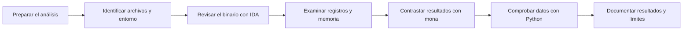

# El Arsenal de un Analista

## Análisis de un buffer overflow con IDA Free, Immunity Debugger, mona y Python

Este repositorio reúne apuntes, guías y ejemplos para trabajar con un fallo de memoria y documentar los resultados con claridad. Parte del [laboratorio de FreeFloat FTP Server 1.0](https://github.com/jonbondani/CVE-2025-5548), relacionado con CVE-2025-5548, y desarrolla el uso conjunto de IDA Free, Immunity Debugger, mona y Python.

La idea es que puedas seguir el análisis, entender lo que aporta cada herramienta y consultar los pasos cuando necesites volver a utilizarlos. Además del caso práctico, encontrarás errores habituales, alternativas y pequeños ejercicios que funcionan sin instalar el servidor vulnerable.

El recurso corresponde a la actividad **El Arsenal de un Analista**, del Módulo 6 de Vulnerabilidades. Está escrito en español y pensado como material de consulta para otros analistas.

## Contenido

- [Guía de operación](docs/01-guia-operacion.md): preparación del entorno, organización de las pruebas y cierre de una sesión.
- [Metodología](docs/02-metodologia.md): flujo de trabajo con diagramas Mermaid y los datos que conviene guardar en cada fase.
- [Caso práctico](docs/03-caso-practico.md): lectura de las capturas de FreeFloat y explicación de sus resultados.
- [Tutorial local](docs/04-tutorial-local.md): ejercicios de orden de bytes, comparación e integridad con Python.
- [Comparativa de herramientas](docs/05-comparativa.md): usos, ventajas y limitaciones de las herramientas del caso y algunas alternativas.
- [Limitaciones](docs/06-limitaciones.md): alcance de las conclusiones y comprobaciones que faltan en el laboratorio original.
- [Resolución de problemas](docs/07-troubleshooting.md): síntomas frecuentes y formas de comprobar su causa.
- [Checklist](docs/08-checklist.md): revisión del análisis y de los archivos antes de compartirlos.
- [Referencias](docs/09-referencias.md): documentación oficial y enlaces al caso original.

Las cheatsheets están separadas por herramienta: [IDA Free](cheatsheets/ida-free.md), [Immunity Debugger](cheatsheets/immunity-debugger.md), [mona](cheatsheets/mona.md) y [Python](cheatsheets/python.md). También hay una [ficha de sesión](plantillas/sesion.md) y una [plantilla de informe](plantillas/informe.md) para reutilizarlas en otros trabajos.

## El caso de FreeFloat

La documentación original permite seguir el análisis de un servidor FTP para Windows, desde la revisión del binario hasta la interpretación de registros y memoria. Las capturas muestran una copia en pseudocódigo, una coincidencia de patrón en la posición 246, EIP con un marcador reconocible, una comparación de bytes y una detención en `INT3`.

Cada resultado necesita su contexto. El offset depende del origen del patrón; una tabla sin cambios solo valida los bytes que se compararon; y una dirección vista en una sesión puede cambiar en otra. El [caso práctico](docs/03-caso-practico.md) explica estos detalles y revisa algunas diferencias entre el relato y las capturas.

Las imágenes proceden de una versión concreta del repositorio y conservan sus bytes originales. El [registro de evidencias](evidencias/README.md) recoge su procedencia y los datos que se pueden leer en ellas.

## Forma de trabajo



IDA ayuda a localizar el código que procesa una entrada. El depurador permite ver el estado del proceso. mona facilita la búsqueda de patrones y la comparación de memoria. Python sirve para comprobar representaciones y archivos. La metodología une esas tareas para que el resultado pueda seguirse sin depender de la memoria de quien hizo la prueba.

## Primeros pasos

Para consultar el caso, empieza por la [guía de operación](docs/01-guia-operacion.md) y continúa con el [análisis de FreeFloat](docs/03-caso-practico.md).

Para practicar directamente, basta con Python 3.10 o posterior. Desde la raíz del repositorio:

```console
python3 herramientas/auditoria_local.py demo
python3 herramientas/auditoria_local.py hash evidencias/capturas/E02-offset-246.png
python3 herramientas/auditoria_local.py compare ejemplos/referencia.hex ejemplos/observado.hex
```

Los archivos del último comando tienen una diferencia introducida a propósito. El programa la detecta y devuelve el código de salida 1. El [tutorial](docs/04-tutorial-local.md) explica cómo interpretar cada resultado.

## Alcance

La guía revisa el laboratorio ya documentado. Las comprobaciones nuevas corresponden a los ejemplos locales de Python, que utilizan datos sintéticos. No se ha repetido la ejecución de FreeFloat para elaborar este recurso ni se presenta un exploit final validado.

El repositorio no incluye el binario vulnerable, shellcode, credenciales ni scripts que envíen entradas de explotación. Las alternativas de herramientas se comentan como opciones para otros análisis, sin atribuirles pruebas que no se han hecho.

## Entrega y reutilización

La [memoria de la actividad](ENTREGA.md) relaciona el contenido con las páginas 4 a 6 del enunciado. La [guía de publicación](docs/10-publicacion.md) recoge los pasos para subirlo a GitHub y enviar la URL.

Antes de reutilizar las capturas o redistribuir el material, consulta el [aviso de uso](AVISO-DE-USO.md). Los hashes de los archivos están en [SHA256SUMS](SHA256SUMS.txt).
