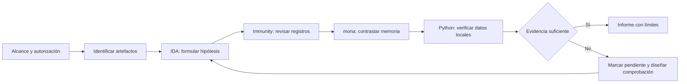

# El Arsenal de un Analista

## De una captura de crash a una conclusión defendible

**IDA Free · Immunity Debugger · mona · Python**  
Recurso técnico de portfolio basado en el laboratorio público de [jonbondani/CVE-2025-5548](https://github.com/jonbondani/CVE-2025-5548). Actividad del Módulo 6, «El Arsenal de un Analista». Edición documental: 21 de octubre de 2026.

Un analista no termina cuando obtiene un registro llamativo: termina cuando otro compañero puede reconstruir qué observó, qué significa y qué sigue sin demostrar. Este arsenal enseña a conectar análisis estático, registros del depurador, comparación de memoria y automatización local, utilizando evidencias de un caso real de laboratorio.

**Estado:** entrega documental preparada y ejemplos locales comprobados. La revisión no ejecutó FreeFloat, no reprodujo crashes y no validó un exploit final. La publicación en GitHub y el envío de su URL están pendientes de autorización del propietario.

## Qué aprenderás

- Rastrear una entrada desde cadenas y referencias cruzadas hasta una operación de copia.
- Interpretar un offset y una sobrescritura de EIP sin convertirlos en una afirmación de ejecución arbitraria.
- Usar mona para reducir errores de alineación y conservar resultados verificables.
- Distinguir bytes excluidos, bytes comparados y bytes realmente demostrados como problemáticos.
- Elegir herramientas según arquitectura, licencias, coste de integración y objetivo.
- Entregar un expediente con fuentes, límites, conclusiones y tareas pendientes.

## Recorridos de lectura

| Necesidad | Empieza aquí | Resultado |
|---|---|---|
| Incorporarte al equipo | [Guía de operación](docs/01-guia-operacion.md) | Preparar y cerrar una sesión con criterios claros |
| Revisar el caso | [Caso y evidencias](docs/03-caso-practico.md) | Separar observaciones de hipótesis |
| Practicar sin laboratorio vulnerable | [Tutorial local](docs/04-tutorial-local.md) | Endianness, integridad y comparación de bytes |
| Trabajar con una chuleta abierta | [IDA](cheatsheets/ida-free.md), [Immunity](cheatsheets/immunity-debugger.md), [mona](cheatsheets/mona.md), [Python](cheatsheets/python.md) | Acciones comentadas y errores habituales |
| Elegir o sustituir herramientas | [Comparativa](docs/05-comparativa.md) | Decisión argumentada sin benchmarks inventados |
| Resolver una sesión bloqueada | [Troubleshooting](docs/07-troubleshooting.md) | Diagnóstico guiado por síntomas |
| Evaluar o entregar | [Matriz académica](ENTREGA.md) y [checklist](docs/08-checklist.md) | Localizar cada requisito y conocer el estado real |

## Flujo de trabajo



El [flujo detallado](docs/02-metodologia.md) explica las entradas, salidas y condiciones de cierre. La ruta se puede recorrer sobre las evidencias incluidas: no requiere lanzar entradas contra un servidor.

## Qué está evidenciado

| Afirmación | Estado de esta entrega |
|---|---|
| El caso fuente documenta FreeFloat FTP Server 1.0, Windows y proceso x86 | Documentado por el repositorio; no se ha inventariado la VM original |
| Existe una captura de pseudocódigo con una copia en la rama de `USER` | Observado en E01; no demuestra por sí sola la causa del fallo en `NOOP` |
| mona muestra una coincidencia en la posición 246 | Observado en E02; relativo al patrón de esa prueba |
| Una captura muestra EIP = `42424242` | Observado en E03; interpretación sujeta al contexto de la sesión |
| mona compara una referencia de 253 bytes y devuelve `Unmodified` | Observado en E05; no prueba el comportamiento de los tres bytes excluidos |
| Una captura muestra EIP en una instrucción `INT3` | Observado en E06; no demuestra fiabilidad entre reinicios ni un exploit final |
| Se han repetido estas pruebas durante esta preparación | **No** |

Los detalles, reservas y enlaces permanentes están en el [registro de evidencias](evidencias/README.md). Los hashes del paquete verifican integridad de los archivos entregados; no acreditan cómo se generó el laboratorio original.

## Valor práctico del caso

El repositorio fuente permite estudiar un fallo de memoria conocido y, además, practicar revisión técnica. Hay que evitar tres saltos lógicos: equiparar una rama de `USER` con la ruta de error de `NOOP`, tratar `Unmodified` como prueba de todos los bytes posibles y atribuir estabilidad a una dirección vista una sola vez. El [análisis del caso](docs/03-caso-practico.md) convierte estas discrepancias en decisiones operativas.

La ficha pública [NVD de CVE-2025-5548](https://nvd.nist.gov/vuln/detail/CVE-2025-5548) vincula FreeFloat FTP Server 1.0 con un buffer overflow relacionado con `NOOP`. Esa atribución externa contextualiza el caso; no sustituye una traza causal del binario analizado.

## Estructura

```text
README.md                    Entrada y rutas de lectura
ENTREGA.md                   Correspondencia con las páginas 4-6 del enunciado
docs/                        Operación, metodología, caso, tutorial y criterios
cheatsheets/                 Cuatro fichas prácticas comentadas
evidencias/                  Registro, capturas y manifiesto de procedencia
herramientas/auditoria_local.py  Utilidad de solo lectura, sin red
ejemplos/                    Datos sintéticos y salida comprobada
plantillas/                  Ficha de sesión e informe reutilizables
CONTRIBUTING.md              Reglas de contribución y revisión
SECURITY.md                  Alcance de publicación
AVISO-DE-USO.md              Autoría, procedencia y derechos
SHA256SUMS.txt               Integridad del contenido del paquete
```

## Inicio rápido sin red

Con Python 3.10 o posterior, desde la raíz del recurso:

```console
python3 herramientas/auditoria_local.py demo
python3 herramientas/auditoria_local.py hash evidencias/capturas/E02-offset-246.png
python3 herramientas/auditoria_local.py compare ejemplos/referencia.hex ejemplos/observado.hex
```

El tercer comando detecta deliberadamente una diferencia y termina con código 1. Véase el [tutorial](docs/04-tutorial-local.md). No se distribuyen scripts de explotación, binarios vulnerables, credenciales, dumps privados ni shellcode.

## Límites y mantenimiento

Las direcciones y offsets históricos no son constantes universales. Faltan hashes del ejecutable y versiones completas de parte del entorno original. Las alternativas de herramientas son propuestas, no migraciones probadas. El repositorio clásico de mona está archivado y remite a mona3; el flujo histórico se conserva para interpretar las capturas, con esa limitación explícita. Ver [limitaciones](docs/06-limitaciones.md) y [referencias](docs/09-referencias.md).

Este recurso desarrolla documentación sobre un caso ya público. Cualquier nuevo indicio se mantiene en una revisión privada hasta confirmar alcance y tratamiento. Las instrucciones de [publicación](docs/10-publicacion.md) son una preparación para el propietario: este paquete no se ha publicado.
