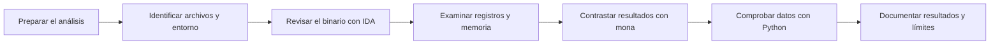

# El Arsenal de un Analista

## Análisis de un buffer overflow con IDA Free, Immunity Debugger, mona y Python

Este repo recoge el análisis de un buffer overflow en [FreeFloat FTP Server 1.0](https://github.com/jonbondani/CVE-2025-5548), relacionado con CVE-2025-5548, utilizando IDA Free, Immunity Debugger, mona y Python.

Lo que se busca es que cualquiera pueda seguir el análisis, entender cómo funciona cada herramienta y revisar los pasos utilizados en el laboratorio.

Este repo corresponde a la actividad **El Arsenal de un Analista**, del Módulo 6 de Vulnerabilidades.

## Contenido

- [Guía de operación](docs/01-guia-operacion.md): preparación del entorno, organización de las pruebas y cierre de una sesión.
- [Metodología](docs/02-metodologia.md): flujo de trabajo con diagramas Mermaid y los datos que conviene guardar en cada fase.
- [Caso práctico](docs/03-caso-practico.md): lectura de las capturas de FreeFloat y explicación de sus resultados.
- [Tutorial local](docs/04-tutorial-local.md): ejercicios de orden de bytes, comparación e integridad con Python.
- [Comparativa de herramientas](docs/05-comparativa.md): usos, ventajas y limitaciones de las herramientas del caso y algunas alternativas.
- [Limitaciones](docs/06-limitaciones.md): alcance de las conclusiones y comprobaciones que faltan en el laboratorio original.
- [Resolución de problemas](docs/07-troubleshooting.md): síntomas frecuentes y formas de comprobar su causa.
- [Checklist](docs/08-checklist.md): revisión del análisis y de los archivos antes de compartirlos.
- [Referencias](docs/09-referencias.md): documentación oficial y enlaces al caso original.

Las cheatsheets están separadas por herramienta: [IDA Free](cheatsheets/ida-free.md), [Immunity Debugger](cheatsheets/immunity-debugger.md), [mona](cheatsheets/mona.md) y [Python](cheatsheets/python.md). También hay una [ficha de sesión](plantillas/sesion.md) y una [plantilla de informe](plantillas/informe.md) para reutilizarlas en otros trabajos.

## El caso de FreeFloat

El laboratorio original recoge los pasos desde la revisión del binario hasta el análisis de registros y memoria. Las capturas muestran una copia en pseudocódigo, una coincidencia de patrón en la posición 246, EIP con un marcador reconocible, una comparación de bytes y una detención en `INT3`.

El offset se cuenta desde el inicio del patrón, la comparación solo valida los bytes incluidos y las direcciones pueden cambiar entre sesiones. El [caso práctico](docs/03-caso-practico.md) explica estos detalles y revisa algunas diferencias entre el relato y las capturas.

Las capturas originales y sus referencias están en el [registro de evidencias](evidencias/README.md).

## Forma de trabajo



Con IDA se localiza el código que procesa la entrada. En Immunity se revisan los registros y la memoria, y con mona se buscan patrones y se comparan los bytes. Python se utiliza para comprobar el orden de esos bytes y los archivos guardados.

## Primeros pasos

El análisis está explicado en la [guía de operación](docs/01-guia-operacion.md) y en el [caso de FreeFloat](docs/03-caso-practico.md).

Los ejemplos locales necesitan Python 3.10 o posterior. Se ejecutan desde la raíz del repo:

```console
python3 herramientas/auditoria_local.py demo
python3 herramientas/auditoria_local.py hash evidencias/capturas/E02-offset-246.png
python3 herramientas/auditoria_local.py compare ejemplos/referencia.hex ejemplos/observado.hex
```

Los archivos del último comando tienen una diferencia introducida a propósito. El programa la detecta y devuelve el código de salida 1. El [tutorial](docs/04-tutorial-local.md) explica cómo interpretar cada resultado.

## Alcance

Este trabajo parte de las pruebas documentadas en el laboratorio original. Para preparar la guía no se ha vuelto a ejecutar FreeFloat. Las pruebas nuevas son las de los ejemplos locales de Python, que usan datos sintéticos. El exploit final no está validado.

El repo no incluye el binario vulnerable, shellcode, credenciales ni scripts de explotación. Las herramientas alternativas se comparan a partir de su documentación; no se ha repetido el laboratorio con ellas.

## Entrega y reutilización

La [memoria de la actividad](ENTREGA.md) relaciona el contenido con las páginas 4 a 6 del enunciado. La [guía de publicación](docs/10-publicacion.md) recoge los pasos para subirlo a GitHub y enviar la URL.

Antes de reutilizar las capturas o redistribuir el material, consulta el [aviso de uso](AVISO-DE-USO.md). Los hashes de los archivos están en [SHA256SUMS](SHA256SUMS.txt).
