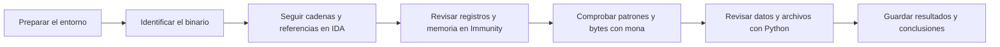

# El Arsenal de un Analista

## Análisis de un buffer overflow con IDA Free, Immunity Debugger, mona y Python

Este repo recoge el análisis de un buffer overflow en [FreeFloat FTP Server 1.0](https://github.com/jonbondani/CVE-2025-5548), relacionado con CVE-2025-5548, utilizando IDA Free, Immunity Debugger, mona y Python.

Lo que se busca es que cualquiera pueda seguir el análisis, entender cómo funciona cada herramienta y revisar los pasos utilizados en el laboratorio.

Este repo corresponde a la actividad **El Arsenal de un Analista**, del Módulo 6 de Vulnerabilidades.

## Contenido

- [Guía de operación](docs/01-guia-operacion.md): entorno, archivos y registro de las pruebas.
- [Metodología](docs/02-metodologia.md): pasos del análisis y diagramas de trabajo.
- [Caso FreeFloat](docs/03-caso-practico.md): análisis de las capturas y explicación de los resultados.
- [Ejemplos con Python](docs/04-tutorial-local.md): orden de bytes, comparación de datos y hashes.
- [Comparativa](docs/05-comparativa.md): herramientas del laboratorio y alternativas.
- [Limitaciones](docs/06-limitaciones.md): datos que faltan y comprobaciones por completar.
- [Resolución de problemas](docs/07-troubleshooting.md): errores habituales y cómo revisarlos.
- [Checklist](docs/08-checklist.md): comprobaciones para una sesión de análisis.
- [Referencias](docs/09-referencias.md): fuentes del caso y documentación de las herramientas.

## Cheatsheets y plantillas

Las fichas de [IDA Free](cheatsheets/ida-free.md), [Immunity Debugger](cheatsheets/immunity-debugger.md), [mona](cheatsheets/mona.md) y [Python](cheatsheets/python.md) recogen las operaciones más utilizadas y los detalles a tener en cuenta.

Para guardar los resultados se incluyen una [ficha de sesión](plantillas/sesion.md) y una [plantilla de informe](plantillas/informe.md).

## Flujo de trabajo



## Ejemplos locales

Necesitan Python 3.10 o posterior y se ejecutan desde la raíz del repo:

```console
python3 herramientas/auditoria_local.py demo
python3 herramientas/auditoria_local.py hash evidencias/capturas/E02-offset-246.png
python3 herramientas/auditoria_local.py compare ejemplos/referencia.hex ejemplos/observado.hex
```

El último comando devuelve el código 1 porque los archivos tienen una diferencia introducida a propósito. El [tutorial](docs/04-tutorial-local.md) explica la salida de cada comando.

## Estado del caso

El análisis parte de las pruebas documentadas en el laboratorio original y de sus [capturas](evidencias/README.md). No incluye una nueva ejecución de FreeFloat ni un exploit final validado. Los ejemplos de Python se han comprobado aparte con datos sintéticos.
