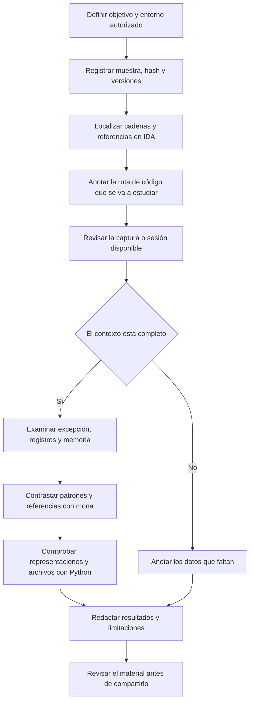
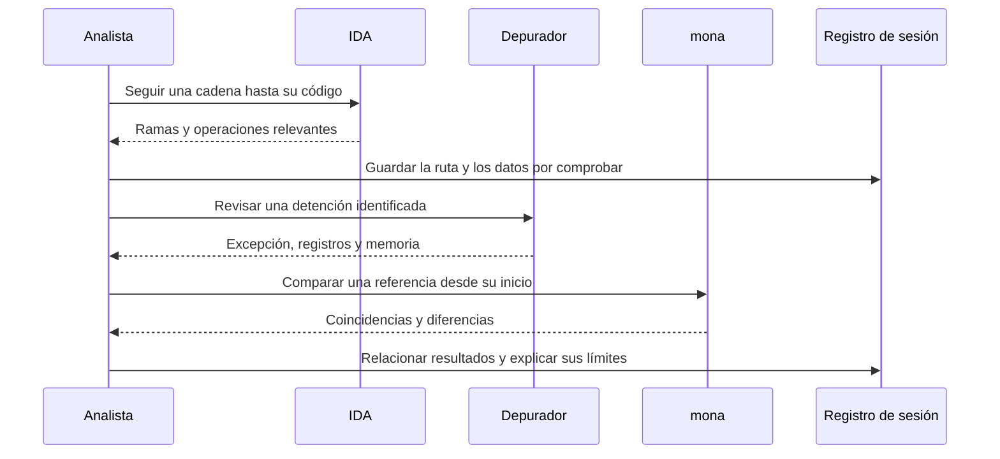

# Metodología de análisis

[Volver al índice](../README.md)

El trabajo combina una revisión estática del código con el estado que muestra el depurador. Los patrones, las comparaciones de memoria y las comprobaciones locales ayudan a relacionar ambos, siempre dentro de una sesión identificada.

## Flujo de trabajo

## Preparación

Registra la muestra, su origen, hash y arquitectura. Añade las versiones del sistema y las herramientas, el snapshot y el objetivo de la sesión. Si se trabaja solo con capturas, deja constancia de esa condición: una imagen permite revisar un resultado, pero no recuperar todo el estado del proceso.

La salida de esta fase es una [ficha de sesión](../plantillas/sesion.md) que identifique los archivos y el entorno. Los datos que no estén disponibles deben quedar señalados.

## Revisión estática

En IDA se parte de las cadenas y sus referencias para localizar el código relevante. A partir de ahí se sigue la procedencia de los datos, las condiciones de cada rama y las operaciones de copia.

El pseudocódigo facilita la lectura, aunque los tipos y nombres pueden ser inferidos. Cuando una conclusión depende de la capacidad de un destino o de un cálculo de punteros, hay que comprobarla también en ensamblador y en los llamadores.

En el caso de FreeFloat, la rama de `USER` aporta una pista sobre una copia. La ruta asociada a `NOOP` necesita su propio seguimiento. La relación entre ambas debe apoyarse en el flujo real del programa.

## Revisión dinámica

El depurador permite observar una detención concreta. Primero se identifica la causa y después se examinan registros, pila y memoria. Un valor reconocible en EIP puede ser compatible con una entrada controlada, pero la relación necesita conservarse con la prueba y sus archivos.

La información mínima incluye proceso, hilo, excepción, registros, instrucción y acción previa. Si se analiza una dirección, también interesan el módulo, su base y los permisos de la página.

## Contraste con mona y Python

mona ayuda a localizar una secuencia en un patrón y a comparar bytes con una referencia. Antes de interpretar el resultado, comprueba el archivo de referencia, la longitud y la dirección del primer byte. ESP puede apuntar al interior del dato.

Python permite revisar el orden de bytes y comprobar que los archivos utilizados siguen siendo los mismos. El hash identifica un archivo; la comparación local señala diferencias. La elección de la referencia y su relación con la sesión siguen siendo responsabilidad del análisis.

## Relación entre estático y dinámico

## Alcance de las conclusiones

Hay varios niveles de información que conviene distinguir:

1. El servicio deja de responder. Todavía hay que separar un problema de red, una pausa y una excepción.
2. El depurador registra una detención. Ya existe un estado que estudiar, aunque su causa puede necesitar más contexto.
3. Aparece un valor compatible con la entrada. La sesión y los archivos permiten comprobar esa relación.
4. Un patrón sitúa el dato en una posición concreta. El offset queda referido al inicio de ese patrón y a esa prueba.
5. Se observa una redirección o una interrupción esperada. La estabilidad entre sesiones y las mitigaciones requieren comprobaciones adicionales.

La documentación debe indicar hasta qué nivel llega la evidencia. El caso incluido permite revisar resultados históricos; los ejemplos locales tienen un registro independiente.

## Cierre

El informe reúne cada observación con su archivo, la interpretación y los datos que falten. Para facilitar otra revisión, cambia una variable cada vez, conserva la referencia original y registra cualquier cambio de configuración. El [caso práctico](03-caso-practico.md) aplica este método a las capturas de FreeFloat.
