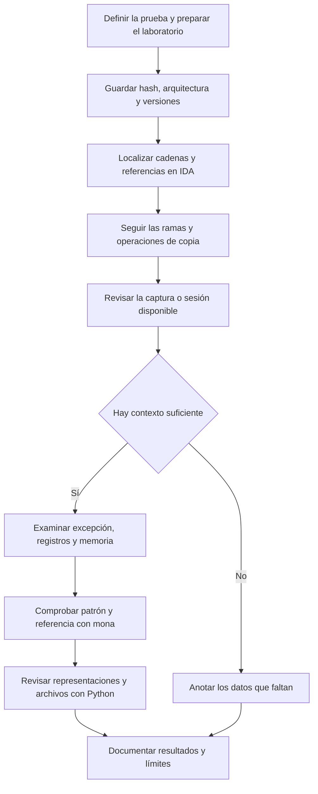
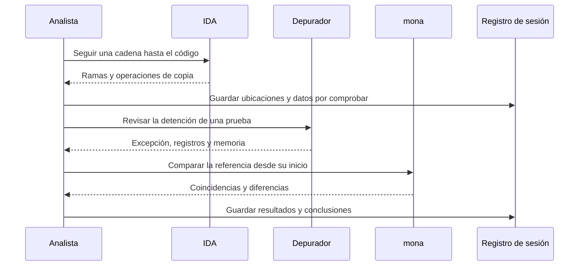

# Metodología de análisis

[Volver al índice](../README.md)

El análisis empieza en IDA, donde se sigue el código que procesa la entrada. Después se revisan los registros y la memoria en el depurador. mona y Python se utilizan para contrastar patrones, bytes y archivos.

## Flujo completo

## Preparación

Define qué se va a comprobar y registra el binario, su origen, hash y arquitectura. Añade sistema, herramientas y snapshot a la [ficha de sesión](../plantillas/sesion.md).

Si solo hay capturas, anota esa condición. Permiten revisar lo visible, pero no recuperar la entrada completa, los hilos o el estado anterior que hayan quedado fuera de la imagen.

## Análisis estático

Parte de las cadenas y sigue sus referencias hasta el código que las utiliza. Revisa las condiciones de cada rama y la procedencia de los datos que llegan a una copia.

El pseudocódigo ayuda a leer la función, aunque los tipos y nombres pueden ser inferidos. Cuando la explicación depende de la capacidad del destino o de un cálculo de punteros, comprueba las instrucciones y los llamadores.

En FreeFloat, la copia localizada en `USER` y la prueba asociada a `NOOP` deben relacionarse siguiendo el código. Estar en el mismo proceso no demuestra que recorran la misma ruta.

## Análisis dinámico

Identifica la detención antes de interpretar sus registros: proceso, hilo, tipo de excepción, instrucción y acción anterior. Conserva también la entrada exacta y la memoria relevante.

Un valor reconocible en EIP puede corresponder a la entrada de prueba. Para comprobarlo hay que relacionar ambas cosas dentro de la misma sesión, con el patrón y el origen del offset bien definidos.

## Comparación de datos

Antes de usar mona, comprueba la referencia, su longitud y la dirección del primer byte. Una comparación desde una posición desplazada puede dar diferencias aunque la tabla esté intacta.

Con Python se revisa el orden de bytes y se comparan archivos. Los hashes ayudan a confirmar que se trabaja con la misma copia. La procedencia y la relación con la sesión quedan en el registro.

## Relación entre herramientas

## Interpretar el resultado

Conviene distinguir los pasos que se han podido comprobar:

1. El servicio deja de responder. Falta separar red, pausa y excepción.
2. El depurador registra una detención. Ya se puede examinar un estado concreto.
3. Aparece un valor relacionado con la entrada. Hay que conservar esa relación con los archivos de la prueba.
4. El patrón devuelve un offset. La medida se refiere al inicio de ese patrón y a esa configuración.
5. Se observa una interrupción o redirección. La repetibilidad y el efecto de las mitigaciones se comprueban por separado.

En el informe se indica hasta dónde llega la evidencia. Si falta un dato, se describe la comprobación necesaria para obtenerlo.

## Cerrar la sesión

Relaciona cada resultado con su archivo y evita mezclar configuraciones distintas. Si se repite una prueba, cambia una variable cada vez y guarda ambas salidas. Así se puede explicar qué cambió y por qué.
