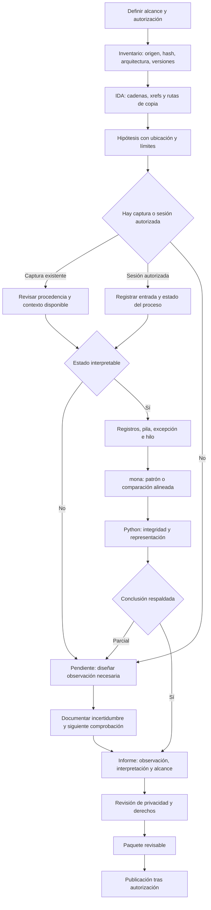
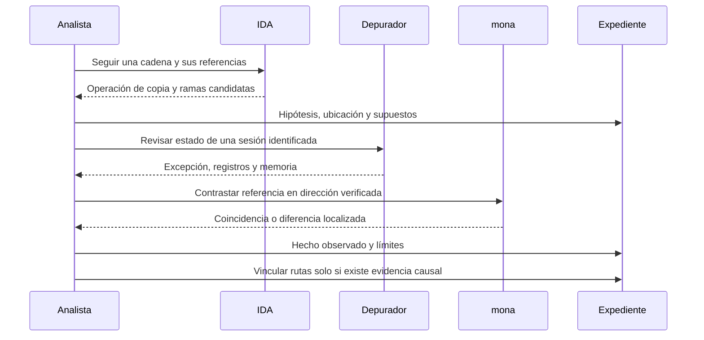

# Metodología: de la hipótesis a la evidencia

[Volver al índice](../README.md)

## Flujo completo con decisiones

## Contratos entre fases

| Fase | Entrada | Acción del analista | Salida mínima | Condición para avanzar |
|---|---|---|---|---|
| Alcance | Encargo y artefactos autorizados | Fijar objetivo y límites | Ficha de sesión | Autorización suficiente para la acción concreta |
| Inventario | Archivos originales | Calcular hash y confirmar arquitectura | Inventario versionado | Se identifica qué muestra se analiza |
| Estático | Binario o capturas de IDA | Seguir datos, llamadas y ramas | Hipótesis localizada | No se confunde pseudocódigo con código fuente |
| Dinámico | Captura o ejecución propia autorizada | Registrar excepción, hilo y contexto | Evidencia con procedencia | El síntoma no se reduce a un timeout |
| Contraste | Patrón o referencia y memoria | Alinear, comparar, conservar salida | Resultado reproducible en su sesión | Se conocen origen, longitud y exclusiones |
| Representación | Números, bytes y archivos | Verificar endian y hashes | Salida local | La transcripción no altera el significado |
| Informe | Hechos e hipótesis | Contrastar afirmaciones y alternativas | Conclusión acotada | Cada afirmación importante tiene fuente |
| Entrega | Paquete revisado | Revisar derechos, enlaces y privacidad | Versión publicable | La publicación dispone de autorización |

Si falta una entrada, se registra la carencia. Una captura permite revisión documental, pero no equivale a disponer del binario y la sesión original.

## Separación entre análisis estático y dinámico

La rama `USER` proporciona una pista estática. El resultado atribuido a `NOOP` necesita su propia ruta: manejador, construcción del mensaje de error y operación efectiva que corrompe memoria. Compartir proceso o contener una copia sin límite no establece esa relación por sí solo.

## Escala de afirmaciones

1. **Síntoma:** el servicio no responde. Explicaciones posibles: pausa del depurador, red, timeout o proceso detenido.
2. **Excepción registrada:** hay una detención y un contexto concreto. Falta determinar causa e influencia de la entrada.
3. **Sobrescritura compatible con la entrada:** un valor reconocible aparece en EIP. Falta preservar correspondencia exacta entre entrada y sesión.
4. **Correlación precisa:** patrón y marcador concuerdan en la misma configuración. El offset no se extrapola a otras rutas.
5. **Redirección observada:** se ve un punto de interrupción coherente con la prueba. La estabilidad y las mitigaciones siguen siendo cuestiones separadas.
6. **Reproducibilidad:** requiere varias sesiones controladas, artefactos y criterios definidos. No está demostrada por una única imagen.

Esta escala describe niveles de evidencia, no una invitación a completar una cadena ofensiva. El recurso se centra en revisar y comunicar lo que existe.

## Tres reglas que ahorran errores

**Una variable por contraste.** Cambiar referencia, dirección y prefijo a la vez impide saber qué corrigió el resultado. Conservar un control conocido antes de una comparación nueva.

**Una identidad por muestra.** Las etiquetas comerciales y nombres de archivo no sustituyen al hash. Si no existe hash, escribir “según la documentación fuente”.

**Una conclusión por alcance.** Que una tabla llegue intacta no significa que todos los bytes del protocolo sean transparentes; que un encabezado no declare NXCompat no determina por sí solo la política DEP efectiva.
