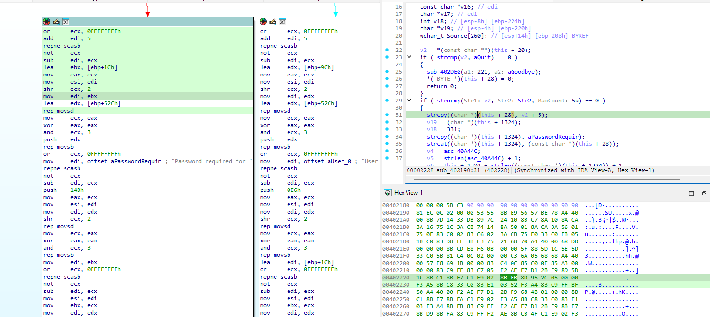
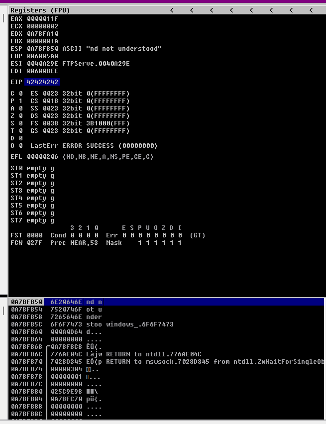
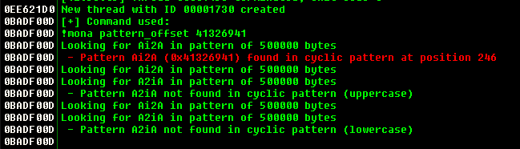
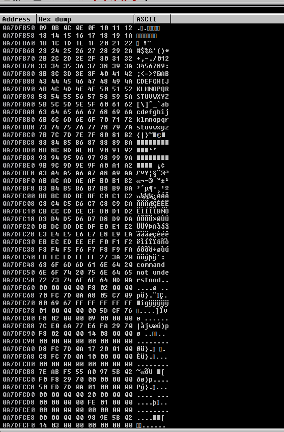
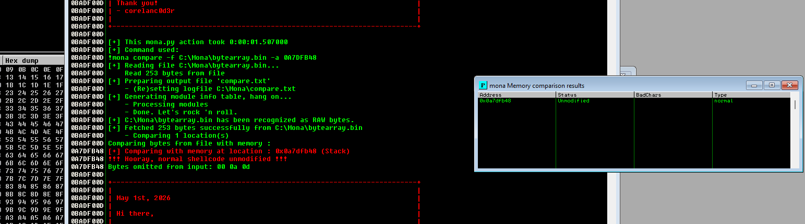
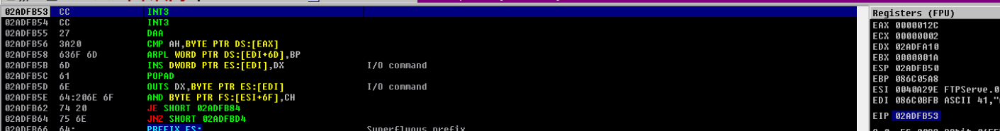

# Caso práctico: FreeFloat FTP Server

[Volver al índice](../README.md)

## Material utilizado

El caso parte de [jonbondani/CVE-2025-5548](https://github.com/jonbondani/CVE-2025-5548), en el commit [`6c302ee05599ce34dae0892f8678bed802879dab`](https://github.com/jonbondani/CVE-2025-5548/tree/6c302ee05599ce34dae0892f8678bed802879dab), del 20 de octubre de 2026. La [ficha de NVD](https://nvd.nist.gov/vuln/detail/CVE-2025-5548) relaciona FreeFloat FTP Server 1.0 con un buffer overflow asociado a `NOOP`.

Se revisan las pruebas ya documentadas y sus capturas, sin una nueva ejecución del servidor. Los archivos originales están identificados en el [registro de evidencias](../evidencias/README.md).

## Entorno

El [laboratorio](https://github.com/jonbondani/CVE-2025-5548/blob/6c302ee05599ce34dae0892f8678bed802879dab/01-Environment/README.md) utiliza Windows 11 en VirtualBox y un snapshot después de instalar las herramientas. El binario se carga como PE 80386 y las imágenes muestran los registros EIP y ESP de un proceso x86.

Para repetirlo con precisión faltan el hash del ejecutable, la build de Windows, las versiones completas de Immunity y mona y la configuración efectiva de memoria y red. El nombre del programa y su versión comercial no identifican la copia concreta que se utilizó.

## La copia localizada en IDA

El análisis sigue cadenas del protocolo y sus referencias hasta `sub_402190`. En E01 se ve una llamada `strcpy` en la rama descrita como `USER`.

`strcpy` no recibe el tamaño del destino. Para saber si puede escribir fuera de sus límites hay que seguir el origen del dato, la capacidad real del destino y las validaciones anteriores.

La expresión `this + 28` tampoco demuestra que el destino sea una variable local en la pila. Hay que revisar cómo se asigna el objeto, dónde se guarda y qué tipos ha reconstruido el decompilador.

Las pruebas posteriores utilizan `NOOP` o comandos no reconocidos y mencionan la construcción de una respuesta de error. Esa ruta necesita seguirse por separado. La copia de `USER` es una pista, pero no basta para identificar la instrucción responsable del crash asociado a `NOOP`.

Para completar esa relación habría que guardar el recorrido desde el parseo hasta la escritura que corrompe memoria, con el origen de los bytes, la capacidad del destino y la pila de llamadas de la misma sesión.

## Del timeout a EIP

Durante el aumento de longitud de las entradas aparece un timeout. El proceso podría estar pausado por el depurador, detenido por una excepción o sin responder por otro motivo. La captura de registros aporta información que el timeout no da.

E03 muestra EIP con `42424242`, el valor de los bytes de `BBBB`.

El valor coincide con el marcador descrito en la prueba. Para reconstruir la relación completa hacen falta la entrada exacta, el hilo, la excepción y el estado anterior a la transferencia.

Esto tampoco demuestra que cualquier valor de cuatro bytes llegue igual. Algunos bytes pueden truncarse o transformarse durante el parseo o las copias de cadenas. La ejecución de órdenes y la repetibilidad necesitan pruebas adicionales.

## El offset 246

E02 muestra `!mona pattern_offset 41326941` y una coincidencia en la posición 246.

En x86 little-endian, `0x41326941` corresponde a los bytes `41 69 32 41`, que se leen como `Ai2A`. Esa es la secuencia que mona localiza en el patrón.

El offset se cuenta desde cero. Los cuatro bytes que empiezan en el índice 246 ocupan los índices 246 a 249; contando posiciones desde uno serían 247 a 250.

El valor no indica que el buffer tenga una capacidad de 246 bytes. Entre el principio del dato y el estado sobrescrito puede haber otros campos, prefijos o transformaciones. La medida solo se puede reutilizar si se conserva su origen y la entrada completa, con comando, espacios y final de línea.

La prueba describe un patrón de 400 bytes. La longitud de búsqueda interna que aparece en mona no significa que se transmitiera esa misma cantidad por red.

## Comparación de bytes y alineación

La referencia excluye `00`, `0a` y `0d`. De los 256 valores posibles quedan 253 bytes para comparar.

E04 muestra parte del dump y E05 recoge el resultado `Unmodified`.

La documentación sitúa el comienzo de la tabla ocho bytes antes de ESP. Ese ajuste pertenece a la prueba descrita. En otra detención hay que localizar el primer byte de nuevo, porque ESP puede apuntar dentro de la secuencia.

Las imágenes son parciales. Se interpretan con la explicación del laboratorio, sin tratarlas como un dump completo del mismo instante.

`Unmodified` indica que la referencia coincide en esa ubicación y en esa prueba. Los tres valores excluidos no se compararon, por lo que esta salida no demuestra su comportamiento individual.

El mensaje de mona utiliza la palabra “shellcode”, pero aquí corresponde a una comparación de bytes. No acredita por sí mismo la ejecución de shellcode funcional.

Una tabla intacta puede parecer alterada si la comparación empieza en otra posición. El [ejemplo local del prefijo](04-tutorial-local.md) reproduce ese problema con datos sintéticos.

## Direcciones e INT3

En la sección de salto a pila hay diferencias entre la dirección escrita, los bytes y la captura del script. No se puede fijar una única representación validada sin resolver esa discrepancia.

E06 muestra EIP en una posición que se decodifica como `INT3`.

La imagen recoge la detención descrita, pero no todos los pasos anteriores ni su estabilidad después de reiniciar. También falta precisar si la interrupción estaba en el dato de prueba o si la insertó el depurador.

Una dirección encontrada en memoria necesita módulo, base, RVA, versión y permisos de la página. Ver los opcodes una vez no garantiza que estén en una ubicación ejecutable o que la dirección se mantenga en otra sesión.

## Mitigaciones

Los atributos de los módulos responden a cuestiones diferentes:

- **ASLR:** disposición de las direcciones.
- **DEP:** ejecución desde páginas de memoria.
- **CFG:** determinadas transferencias indirectas.
- **SafeSEH:** manejadores de excepciones en los entornos donde se aplica.

`NXCompat = False` no basta para afirmar que DEP esté desactivado. Hay que comprobar la política del proceso y los permisos de la página. Del mismo modo, un módulo sin declaración de ASLR no demuestra una dirección estable en cualquier sistema.

Para estudiar esa estabilidad se necesitan sesiones independientes, también después de reiniciar, con el inventario de módulos y sus bases y RVA.

## Comprobaciones por completar

- Guardar hash, origen y arquitectura confirmada del ejecutable.
- Seguir la ruta `NOOP` hasta la operación que corrompe memoria.
- Conservar el patrón y la entrada completos, con el origen del offset.
- Registrar referencia, longitud, inicio de la comparación y registros del mismo instante.
- Separar las exclusiones preventivas de los comportamientos observados.
- Resolver la diferencia entre las representaciones de la dirección.
- Repetir las pruebas en sesiones identificadas y comparar los resultados tras reiniciar.

En la versión consultada, el README original figura como “Finalizado”, pero los apartados de shellcode y exploit final siguen pendientes. Por tanto, el análisis documentado no acredita un exploit final validado.
